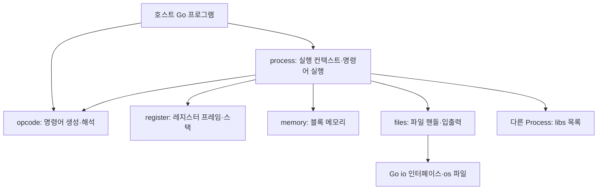

# smips 구현에서 역도출한 설계

- 분석일: 2026-10-24
- 기준 커밋: `89668635677b26c6f2c604e66eec24ef998af3fa`
- 대상: README, 전체 Go 소스, `go.mod`
- 상태: 해당 커밋의 구현을 설명하는 분석 기록. 새로운 설계의 승인이나 변경 계획을 뜻하지 않는다.
- 독자: 현재 구조를 이해하거나 후속 구현을 이어갈 개발자

이 문서는 **구현 사실**, **주석·구조로부터 복원한 의도**, **미확정 사항**을 구분한다. 현재 동작의 근거는 링크한 소스이며, 코드가 변경되면 관련 설명과 검증 결과를 다시 확인해야 한다. README와 주석이 실행 코드와 충돌하는 경우 그 차이를 명시한다.

## 1. 시스템의 성격

smips는 Go 프로그램에 포함해서 사용할 수 있도록 구성된 **64비트 고정 길이 명령어, 64비트 레지스터 기반 인터프리터 VM**이다. 명령어는 레지스터 번호를 지정하며, 메모리 접근은 블록 핸들과 블록 내부 오프셋을 별도로 사용한다.

`Process`가 명령어 배열, 프로그램 카운터, 레지스터 프레임 스택, 메모리, 파일 테이블, 호출 가능한 다른 `Process`의 목록을 소유한다. 명령어를 하나씩 실행하는 `Eval()`과 반복 실행하는 `Execute()`를 제공한다. 이름의 `Process`는 VM 실행 컨텍스트이며, OS 프로세스 생성이나 병렬 스케줄링은 구현되어 있지 않다.

외부 의존 모듈, `main`, CLI, 어셈블러, 바이너리 로더, 예제, 테스트 파일은 없다. 호스트가 Go API로 명령어와 프로세스를 구성하는 형태로 해석할 수 있다. 다만 현재 생성자 결함 때문에 정상적인 실행 시작은 막혀 있다.

근거: [go.mod](../go.mod), [Process 정의와 생성](../process/process.go#L10), [실행기](../process/execute.go#L11).

## 2. 구성요소와 의존 관계



| 패키지 | 소유하는 상태·책임 | 경계의 특징 |
| --- | --- | --- |
| `opcode` | 명령어 비트 배치, 연산 번호, 인코더·디코더 | 실행 상태를 갖지 않는 명령어 계약 |
| `register` | 프레임 내부 값, 프레임 스택, 인자·반환값 복사, 풀 재사용 | 실행기는 스택 최상단 프레임을 대상으로 읽고 쓴다 |
| `memory` | `map[uint64]*Block`, 해제된 핸들 목록 | 주소는 호스트 포인터가 아닌 블록 식별자 |
| `files` | 파일 핸들 테이블, 표준 입출력, 열린 파일 | VM 핸들을 Go `io` 인터페이스와 연결 |
| `process` | 위 구성요소, 명령어 배열, PC, 라이브러리 목록 | 구체 패키지를 직접 조합하며 ISA 실행과 시스템 호출을 담당 |

독립 서비스나 별도 배포 단위로 분리된 구조는 아니다. 하나의 Go 라이브러리 안에서 상태와 책임을 패키지로 나눈 형태다. 특히 `process` 패키지에는 실행기뿐 아니라 문자열 메모리 표현과 시스템 호출 ABI도 들어 있다.

근거: [Process 필드](../process/process.go#L10), [시스템 호출](../process/systemcall.go#L5), [문자열 표현](../process/string.go#L7).

## 3. 명령어와 값 모델

### 3.1 고정 길이 명령어

`Opcode`는 `uint64`다. 주석과 생성 함수가 나타내는 배치는 다음과 같다. 표는 상위 비트부터 기재했다.

| 형식 | 63…56 | 55…40 | 39…24 | 23…8 | 7…0 |
| --- | --- | --- | --- | --- | --- |
| Regular | `data:8` | `ra:16` | `rb:16` | `rd:16` | `op:8` |
| Wide | `wide-data`의 일부 | `wide-data`의 일부 | `wide-data`의 일부 | `rd:16` | `op:8` |

Wide의 정확한 구획은 `[63:24] wide-data:40 / [23:8] rd:16 / [7:0] op:8`이다. 별도의 형식 구분 비트는 없으며 연산 종류가 필드 해석을 정한다. `OpSet`은 Wide 값을 사용하고, 다수 연산은 Regular의 레지스터 필드를 사용한다.

**현재의 디코더는 이 배치와 일치하지 않는다.** 생성자가 맞게 비트를 배치해도 읽을 때 다른 레지스터 번호와 연산 번호가 나온다. 따라서 이 표는 생성 함수와 주석에서 복원한 형식이며, 현재 실행기가 일관되게 준수하는 ISA로 볼 수 없다.

근거: [생성 함수와 디코더](../opcode/opcode.go#L3).

### 3.2 레지스터 값과 연산

레지스터는 타입 태그 없는 `uint64`를 저장한다. 정수 연산은 이 값을 그대로 사용하고, 실수 연산은 `math.Float64frombits` / `Float64bits`로 IEEE 754 비트 표현을 재해석한다. 정수·실수·메모리 주소·파일 핸들을 구별하는 런타임 타입 검사는 없다.

| 연산군 | 구현으로 확인되는 의미 |
| --- | --- |
| 정수 산술 | 덧셈, 뺄셈, 곱셈, 나눗셈, 나머지. 결과와 보조 값을 `rd`, `Hi`에 저장하려는 구조 |
| 비트 | AND, OR, XOR, NOT, 좌우 시프트 |
| 실수 | float64 덧셈, 뺄셈, 곱셈, 나눗셈. `OpFMod`는 번호만 정의되어 있다 |
| 즉시값 | `OpSet`: Wide 즉시값을 `rd`에 저장 |
| 제어 흐름 | `OpJmp`, `OpEq`, `OpNeq`로 PC 변경 |
| 메모리 | 할당, 읽기, 쓰기 |
| 외부 호출 | 라이브러리 Process 실행, 파일 시스템 호출 |

`OpEq`와 `OpNeq`는 주석의 `rd = 비교 결과`와 다르게 **조건 분기**로 구현되어 있다. 조건이 참이면 `PC = R[rd]`다. `OpJmp`는 `PC = R[ra]`를 수행한다. 라이브러리 호출은 이와 달리 `libs[ra]`로 접근하므로 `ra` 자체가 목록 인덱스다.

근거: [연산 목록](../opcode/op.go#L7), [산술·분기·메모리·호출 실행](../process/execute.go#L17).

## 4. 레지스터 프레임과 호출 규약

### 4.1 프레임 구조

하나의 프레임은 예약 필드 4개와 길이가 각각 16,383인 `params`, `temporary`, `extra`, `returns` 배열을 갖는다. 총 65,536개의 `uint64`, 즉 값 저장 공간만 512 KiB다. 프레임 객체는 `sync.Pool`로 재사용하도록 되어 있다.

| 영역 | 복원되는 역할 |
| --- | --- |
| `zero`, `one`, `two`, `four` | 초기값 0, 1, 2, 4를 제공하려는 예약 필드 |
| `params` | 현재 호출의 입력 값 |
| `temporary` | 현재 호출의 작업 값 |
| `extra` | 호출할 대상에 보낼 인자, 호출 후 받은 반환값 |
| `returns` | 현재 호출이 상위 호출자에게 돌려줄 값 |
| `Hi` | `temporary[16382]`를 별칭으로 사용하는 산술·입출력 보조 결과 |

예약 필드는 `Set()`으로 수정할 수 있어 읽기 전용 상수는 아니다. `Hi`도 일반 임시 레지스터와 같은 저장 공간이다.

**현재 `Get/Set`의 실제 주소 매핑**은 다음과 같다. README의 예약 주소 설명이나 물리적 프레임 배치를 그대로 주소 공간으로 간주하면 안 된다.

| 주소 | 접근 대상 |
| --- | --- |
| `0`, `1`, `2`, `4` | 해당 예약 필드. README의 `0, 1, 2, 3`과 다름 |
| 그 외 `0…16382` | `params[index]` |
| `16383…32765` | `temporary[index - 16383]` |
| `32766…49148` | `extra[index - 32766]` |
| `49149…65531` | `returns[index - 49149]` |
| `65532…65535` | 배열 범위를 벗어나 패닉 |

그 결과 `params[0,1,2,4]`는 전용 `GetParams/SetParams`로는 접근되지만 일반 `Get/Set`으로는 접근되지 않는다. 따라서 전체 16비트 주소를 균일하게 사용할 수 있다는 계약은 성립하지 않는다.

근거: [프레임 정의와 초기화](../register/reg.go#L5), [주소 매핑](../register/reg.go#L102), [Hi 별칭](../register/reg.go#L186).

### 4.2 의도된 호출 규약

`Stack.Call`과 `Stack.Plunder`는 다음 데이터 이동을 구현한다.

```text
호출 전: caller.extra[i]   → callee.params[i]
호출 중: callee.temporary, callee.returns 사용
복귀 후: callee.returns[i] → caller.extra[i]
         callee 프레임은 풀로 반환
```

사용한 인자 수와 관계없이 16,383개 값 전체를 복사한다. 호출·복귀마다 각 방향으로 약 128 KiB를 복사하는 구조다. `Stack` 자체에는 반환 PC가 없고, 바이트코드의 함수 진입 주소를 저장하는 기능도 없다.

**프로세스 간 연결은 미완성이다.** `OpLib`는 호출자 `p.stack`에 프레임을 추가한 뒤, 별도 스택을 가진 `p.libs[ra].Execute()`를 실행하고 호출자 스택에서 프레임을 제거한다. 라이브러리 스택으로 인자가 옮겨지거나 라이브러리의 반환값이 호출자로 옮겨지는 코드는 없다. 생성자 결함을 제외해도 이 경로는 의도된 프로세스 간 호출 규약을 충족하지 않는다.

근거: [스택 호출·복귀](../register/reg.go#L74), [OpLib](../process/execute.go#L86), [Process별 스택 생성](../process/process.go#L21).

## 5. 메모리와 문자열

### 5.1 블록 핸들 기반 메모리

메모리는 `handle → Block{Value: []uint8, Count: uint64}` 테이블이다. 접근은 `(handle, offset)` 쌍으로 수행한다. 하나의 연속 주소 공간에서 포인터 산술을 하는 모델과 다르게, 블록 선택과 내부 바이트 위치가 분리되어 있다.

- `Alloc(size)`는 0으로 초기화된 바이트 배열을 만들고 핸들을 반환한다. 0도 유효한 핸들이다.
- `Free(handle)`는 블록을 삭제하고 핸들을 재사용 목록에 넣는다. 다음 할당은 최근 해제 핸들을 우선 사용한다.
- 존재하지 않는 블록 또는 범위 밖 위치를 읽으면 0을 반환한다. 같은 위치에 쓰면 패닉이다.
- 핸들은 재사용되며 세대 번호는 없다. 해제 전 핸들이 남아 있으면 새 블록을 가리킬 수 있다.
- `Count`는 할당 시 1로 설정될 뿐 사용되지 않는다. 참조 계수나 GC가 구현되었다고 볼 근거는 없다.
- `Free` 메서드는 있지만 바이트코드의 해제 명령이나 시스템 호출은 없다.

`OpLoad/OpStore`는 바이트를 상위 바이트부터 결합·분해하려는 빅엔디언 구조다. 크기는 `data & 0b111`이므로 현재 표현 범위는 **0…7바이트**이며 8은 0으로 처리된다. `OpStore`의 반복문은 별도 결함으로 정상 종료하지 못한다.

근거: [메모리 구현](../memory/memory.go#L3), [메모리 명령](../process/execute.go#L70).

### 5.2 문자열 메모리 표현

주석과 코드 구조에서 복원되는 문자열 ABI는 다음과 같다.

```text
8바이트: rune 개수, 빅엔디언 uint64
4바이트 × rune 개수: 각 rune의 값, 빅엔디언
총 크기: 8 + 4 × rune 개수
```

Go의 `[]rune`를 사용하며 UTF-8 바이트 배열이나 NUL 종료 문자열과는 다르다. `AddStringArgs`는 문자열을 프로세스 메모리에 저장하고 핸들을 `params`에 넣으려 한다. 파일 열기 시스템 호출은 이 표현을 읽어서 호스트 경로로 변환한다.

현재 직렬화·역직렬화에는 결함이 있다. `WriteString`은 길이 바이트의 위치를 이동하지 않으며, 비어 있지 않은 문자열에서는 rune 쓰기 오프셋이 언더플로되어 패닉이 난다. `ReadString`은 길이 헤더 중 0바이트를 만나면 즉시 빈 문자열을 반환하므로 정상적인 짧은 문자열의 헤더도 읽지 못한다. `AddStringArgs`의 `paramCount`도 증가하지 않는다.

근거: [문자열 읽기·쓰기](../process/string.go#L7), [호스트 인자 등록](../process/process.go#L41), [파일 경로 변환](../process/systemcall.go#L7).

## 6. 호스트 입출력 경계

`files.Files`는 VM 파일 핸들을 Go 객체로 대응시킨다. 0, 1, 2는 표준 입력·출력·오류로 초기화된다. 일반 파일은 읽기, 생성/덮어쓰기, 이어쓰기 모드로 열 수 있다. 테이블은 `interface{}`를 저장하고 각 연산에서 `io.Reader`, `io.Writer`, `io.ReaderAt`, `io.WriterAt`, `io.Closer` 지원 여부를 확인한다.

`Files`에는 표준 입출력을 대체하는 메서드가 있지만 `Process.files`는 비공개이고 Process의 공개 API에는 이를 전달하는 통로가 없다. `files` 패키지 수준의 교체 기능과 VM 전체의 호스트 설정 API를 구별해야 한다.

| 시스템 호출 | 입력 | 출력 |
| --- | --- | --- |
| `OpenFile` | `R[ra]`: 문자열 핸들, `R[rb]`: 모드 | `R[rd]`: 파일 핸들 |
| `CloseFile` | `R[ra]`: 파일 핸들 | `R[rd]`: 1 또는 0 |
| `ReadFile` | `R[ra]`: 파일 핸들, `data`: 크기 | `R[rd]`: 읽은 바이트를 결합한 값 |
| `ReadFileAt` | 위 입력 + `R[rb]`: 파일 오프셋 | `R[rd]`: 읽은 값 |
| `WriteFile` | `R[ra]`: 파일 핸들, `data`: 크기, `R[rd]`: 쓸 값 | `Hi`: 구현상 성공 시 1 |
| `WriteFileAt` | 위 입력 + `R[rb]`: 파일 오프셋 | `Hi`: 구현상 성공 시 1 |

쓰기 주석은 `Hi`에 쓴 바이트 수가 들어간다고 하지만 구현은 성공 여부 1을 반환한다. 읽기·쓰기의 실제 바이트 수는 버리고, EOF를 포함한 `error`는 패닉으로 처리한다. 크기 필드는 메모리 연산과 같이 하위 3비트만 사용한다.

파일 경로는 `os` API로 직접 전달된다. 경로 제한, 권한 정책, VM trap 변환은 없다. 따라서 현재 구조에서 호스트 파일 접근 권한을 별도로 제한하는 샌드박스를 도출할 수 없다.

근거: [파일 테이블·모드·교체 API](../files/files.go#L8), [입출력](../files/files.go#L91), [시스템 호출 연결](../process/systemcall.go#L5).

## 7. 실행과 자원 수명

복원되는 의도된 사용 흐름은 다음과 같다. 현재 성공하는 사용 예제를 뜻하지 않는다.

```text
호스트에서 opcode 배열 구성
  → Process.New(opcodes...)
  → 선택적으로 AddLib / AddStringArgs
  → Execute()
      → Eval() 반복
          → 명령어 해석
          → 연산 / 메모리 / 라이브러리 / 시스템 호출
      → PC가 명령어 배열 길이 이상이면 종료
```

실제 `Eval`은 PC 범위를 확인한 **다음 PC를 먼저 증가시키고** 그 위치의 명령어를 읽는다. 초기 PC가 0이므로 첫 명령을 건너뛰고, 일반적인 순차 실행은 배열 끝에서 패닉에 도달한다. 점프로 지정한 PC도 다음 `Eval`에서 증가한 뒤 읽힌다.

프로세스별로 `New`가 메모리·파일 테이블·스택을 새로 만든다. 라이브러리는 `*Process` 참조로 등록하며 실행 상태를 그대로 재사용한다. 호출마다 PC를 초기화하거나 새로운 실행 인스턴스를 만드는 코드는 없다. 같은 라이브러리 객체를 여러 호출자에 등록할 수 있지만 동시 접근을 보호하는 장치는 없다.

종료 명령, 취소, 명령 수 예산, 프로세스 정리 API, 열린 파일 전체 닫기, 최종 프레임 반환, 호스트에 실행 결과를 읽어주는 API는 없다. 실패는 여러 곳에서 Go 패닉으로 전파되고 VM trap이나 오류 반환으로 일원화되어 있지 않다. 미등록 연산은 시스템 호출 분기로 이동한 뒤 조용히 무시된다.

근거: [실행·종료 조건](../process/execute.go#L11), [라이브러리 등록](../process/process.go#L36), [시스템 호출 switch](../process/systemcall.go#L5).

## 8. 설계 의도와 구현의 주요 차이

아래는 구조를 해석할 때 반드시 고려할 차이다. 개선 작업을 수행하거나 새 동작을 결정한 목록은 아니다.

| 항목 | 확인된 현재 상태 | 설계 해석에 주는 영향 |
| --- | --- | --- |
| 프레임 초기화 | `temporary[16383]`부터 범위 초과. `extra` 초기화도 없음 | `register.New`, `Process.New`가 패닉. 풀 재사용 시 extra 초기화 계약도 불완전 |
| 명령어 해석 | 인코더와 `Ra/Rb/Rd/Op/WideData`의 시프트 불일치 | 생성·실행 간 명령어 계약이 깨져 있음 |
| 명령어 인출 | PC 선증가 후 배열 접근 | 첫 명령 누락, 순차 실행 끝에서 패닉 |
| 레지스터 주소 | 예약 주소·배열 오프셋 충돌, 최상위 네 주소 범위 초과 | 16비트 전체 주소 공간의 일관된 매핑이 미완성 |
| 라이브러리 ABI | 호출자 스택만 push/pop, 별도 Process 실행 | 인자와 결과가 라이브러리 스택에 연결되지 않음 |
| 반복 라이브러리 호출 | 기존 Process의 PC와 상태 재사용 | 호출별 초기 상태·재실행 의미가 정의되지 않음 |
| 덧셈 | `bits.Add64`의 `(sum, carryOut)`를 `(hi, lo)`로 받음 | `rd`에 carry, `Hi`에 sum을 저장 |
| 저장·파일 쓰기 | 부호 없는 인덱스를 `i >= 0; i++`로 반복 | 정상적인 역순 저장이 되지 않고 범위 초과 패닉 |
| 문자열 | 잘못된 쓰기 위치·헤더 0바이트의 조기 종료 | 인자·파일 경로를 포함한 문자열 ABI가 작동하지 않음 |
| 문자열 인자 | `paramCount` 증가 누락 | 다른 결함을 제거해도 모든 인자가 같은 params 위치를 사용 |
| 비교 | 주석은 값 생성, 실행기는 조건 분기 | 후속 구현 시 어느 의미를 보존할지 확정 필요 |
| 실수 나머지·메모리 해제 | `OpFMod` 실행 없음, `Free` 명령 없음 | API·연산 선언과 VM에서 실제 제공하는 기능이 다름 |
| I/O 결과·오류 | 쓰기 결과는 1, 실제 전송 길이 무시, EOF도 패닉 | 바이트 수·부분 전송·종료·오류 ABI가 미확정 |

근거: [register](../register/reg.go#L26), [opcode](../opcode/opcode.go#L8), [실행기](../process/execute.go#L11), [문자열](../process/string.go#L13), [파일 쓰기](../files/files.go#L138).

## 9. 검증 근거와 한계

분석 환경은 `go1.27.3 windows/arm64`다. 다음 명령은 모두 통과했다.

```powershell
go test ./...
go vet ./...
```

다만 다섯 패키지 모두 `[no test files]`이므로 테스트 명령의 성공은 컴파일 가능성을 확인하는 수준이다. VM의 정상 실행이 검증되었다는 의미는 아니다.

추가로 레포 외부의 임시 Go 프로그램에서 공개 API를 호출하여 다음을 확인했다. 해당 프로그램은 분석용이며 레포에 테스트나 실행 코드로 추가하지 않았다.

| 실행 확인 | 관측 결과 |
| --- | --- |
| Regular 생성 후 읽기 | 입력 `data=12, ra=3456, rb=789a, rd=bcde, op=1f` → `data=12, ra=1234, rb=5678, rd=9abc, op=de` (16진수) |
| Wide 생성 후 읽기 | 입력 `wide=123456789a, rd=bcde, op=12` → `wide=48d159e26af3, rd=9abc, op=de` (16진수) |
| `register.New()` / `process.New()` | 둘 다 `index out of range [16383] with length 16383` |
| `WriteString("A")` | `memory: set: offset out of range` 패닉 |
| 정상 헤더로 직접 저장한 `A` 읽기 | 빈 문자열 반환 |
| stdout을 `bytes.Buffer`로 바꾼 뒤 2바이트 쓰기 | `index out of range [2] with length 2` |
| `new(register.Register)`로 생성자를 우회한 같은 스택의 호출·복귀 | `extra[0]=42`가 자식 `params[0]`으로, 자식 `returns[0]=99`가 부모 `extra[0]`으로 복사 |
| 메모리 할당·해제·재할당 | 핸들 0 재사용, 새 블록의 바이트는 0 |

PC, 산술, 프로세스 간 호출, 자원 수명에 대한 설명은 소스 분석 결과다. 생성자부터 정상 작동하지 않으므로 전체 프로그램의 성공 실행이나 라이브러리 호출 통합을 검증했다고 주장하지 않는다.

## 10. 복원된 설계 방향과 남은 결정

구조와 주석을 함께 보면 **고정 길이 ISA와 큰 레지스터 프레임을 사용하고, 호출 규약으로 Process들을 조합하며, 메모리와 호스트 I/O를 정수 핸들로 연결하려는 VM**이라는 설계 의도를 복원할 수 있다. 단순한 자료구조, 명시적인 바이트 조합, 프레임 풀 재사용이 구현상의 특징이다. 이러한 선택의 역사적 이유나 성능 목표를 증명하는 자료는 없다.

후속 구현 전에 결정할 필요가 있는 부분은 다음과 같다.

1. **호출 단위:** 별도 Process를 호출할 것인지, 하나의 Process 안에서 프레임과 PC를 전환할 것인지. 현재 두 모델이 연결되지 않은 채 함께 있다.
2. **상태 공유:** 라이브러리에 전달하는 정수 핸들이 어느 메모리·파일 테이블에 속하는지, 데이터를 복사할지 공유할지. 같은 숫자의 핸들은 Process 사이에서 같은 객체를 의미하지 않는다.
3. **ISA·ABI의 기준:** 생성자의 비트 배치, 레지스터 주소, 비교 연산, 전송 크기 8바이트, I/O 결과의 의미를 무엇으로 확정할지.
4. **호출 수명:** 재호출 시 PC·레지스터 초기화와 메모리·파일 정리의 범위, 호스트가 최종 결과를 얻는 방법.
5. **실패 계약:** 잘못된 opcode, 범위 초과, 0 나누기, EOF, 파일 오류를 Go 패닉과 VM의 오류 중 어떻게 표현할지.

위 항목은 현재 코드로 확정할 수 없는 설계 질문이며, 이 문서에서 새로운 정책으로 정하지 않는다.
